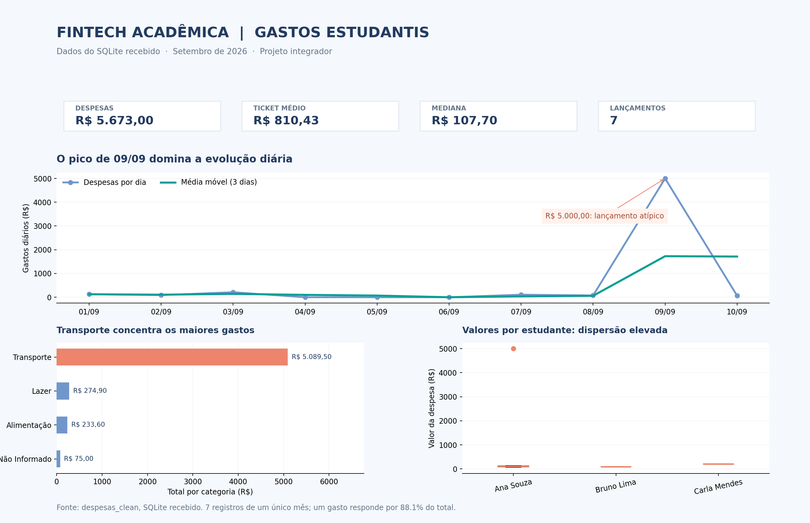

# Fintech Acadêmica — Projeto Integrador

**Autoria:** Sophia Cristine Soares Mello  
**Disciplina:** Projeto Integrador de Software  
**Tecnologias:** Python, SQLite, Pandas, Matplotlib, Plotly, scikit-learn e Streamlit

Este repositório reúne as atividades das Semanas 1 a 10. A primeira atividade é sobre gestão de estoque; da Semana 2 em diante, o projeto evolui para uma aplicação de acompanhamento de despesas estudantis.

A proposta da Fintech Acadêmica é organizar lançamentos, analisar os gastos por estudante e categoria e testar uma previsão para a próxima despesa. É um projeto acadêmico: não há movimentação bancária, receitas nem um modelo preparado para uso financeiro real.

## Aplicação Streamlit

O aplicativo reúne indicadores financeiros, gráficos de despesas, auditoria dos dados e uma previsão experimental.

[Acessar a aplicação no Streamlit Cloud](https://fintech-academica-projeto-integrador-final.streamlit.app/)

*A captura da interface poderá ser incluída aqui depois de salvar a imagem real como `captura_app_streamlit.png` na raiz do repositório.*

## Arquivos e entregas

Cada atividade ficou em sua própria pasta. Os notebooks foram salvos com as saídas da execução, incluindo tabelas e gráficos.

| Semana | Pasta / arquivo principal | Conteúdo |
|---|---|---|
| 1 | [`semana_01_gestao_de_estoque/gestão_de_estoque.ipynb`](semana_01_gestao_de_estoque/gestão_de_estoque.ipynb) | Exercício de estoque e análise com Pandas |
| 2 | [`semana_02_modulo_validacao_financeira/modulo_validacao_financeira.ipynb`](semana_02_modulo_validacao_financeira/modulo_validacao_financeira.ipynb) | Regras de validação de despesas |
| 3 | [`semana_03_atividade_poo/atividade_poo.ipynb`](semana_03_atividade_poo/atividade_poo.ipynb) | Classes `Estudante`, `Despesa` e `GestorFinanceiro` |
| 4 | [`semana_04_subsistema_dados_geograficos/subsistema_dados_geograficos.ipynb`](semana_04_subsistema_dados_geograficos/subsistema_dados_geograficos.ipynb) | Consulta de municípios pela API do IBGE |
| 5 | [`semana_05_persistencia_sql/persistencia_sql.ipynb`](semana_05_persistencia_sql/persistencia_sql.ipynb) | Estrutura do banco, SQL, JOIN, integridade e transações |
| 6 | [`semana_06_data_wrangling/data_wrangling.ipynb`](semana_06_data_wrangling/data_wrangling.ipynb) | Auditoria dos dados, limpeza e IQR |
| 7 | [`semana_07_eda_estatistica/eda_estatistica.ipynb`](semana_07_eda_estatistica/eda_estatistica.ipynb) | Estatística descritiva e análise exploratória |
| 8 | [`semana_08_storytelling_visual/storytelling_visual.ipynb`](semana_08_storytelling_visual/storytelling_visual.ipynb) | Dashboard e interpretação dos indicadores |
| 9 | [`semana_09_modelo_preditivo/modelo_preditivo.ipynb`](semana_09_modelo_preditivo/modelo_preditivo.ipynb) | Regressão linear, comparação de MAE e exportação `.joblib` |
| 10 | [`semana_10_app_streamlit/`](semana_10_app_streamlit/) | Aplicativo, SQLite, modelo, dependências e testes |

O arquivo [`modelo_despesas.joblib`](modelo_despesas.joblib) também está na raiz, como entregável da Semana 9. A cópia utilizada pelo aplicativo fica na pasta da Semana 10.

## Resumo das atividades

### Semana 1 — Gestão de estoque

- **Organização dos dados:** montei um DataFrame no Pandas com 10 produtos de quatro categorias, incluindo preço e quantidade disponível.
- **Valor e quantidade do estoque:** a soma chegou a **111 unidades** e **R$ 66.310,00** em mercadorias (`preço × quantidade`).
- **Produtos e categorias:** o Notebook foi o item mais caro (R$ 3.500,00), enquanto o Mouse tinha a maior quantidade (25 unidades). Eletrônicos foi a categoria com maior valor em estoque (**R$ 46.950,00**).
- **Estoque baixo:** usando o critério de menos de 10 unidades, identifiquei cinco produtos para acompanhamento: Notebook, Cadeira Gamer, Webcam, Impressora e Mesa de Escritório.

### Semana 2 — Módulo de validação financeira

- **Regras de entrada:** a função `validar_despesa` exige valor numérico, finito e maior que zero, data no formato `datetime` e categoria permitida.
- **Testes:** executei nove casos: dois lançamentos válidos foram aceitos e sete entradas inválidas foram rejeitadas, incluindo valor negativo, zero, texto, infinito, data incorreta e campo ausente.
- **Resultado:** apenas os dois registros aprovados entraram na lista de despesas. Nesta etapa, o armazenamento ainda é em memória.

### Semana 3 — Programação Orientada a Objetos

- **Estrutura:** dividi o código nas classes `Estudante`, `Despesa` e `GestorFinanceiro`. A classe `Despesa` usa atributos privados e métodos de acesso e alteração com validação.
- **Consolidação:** associei três despesas a um estudante e obtive **R$ 138,30** no relatório financeiro.
- **Consistência:** valores inválidos e categorias desconhecidas são rejeitados antes que uma despesa seja adicionada ao gestor.

### Semana 4 — Subsistema de dados geográficos

- **API do IBGE:** implementei duas etapas de consulta: obter os códigos das UFs pelo endpoint de estados e, depois, buscar os municípios pela sigla informada.
- **Tratamento de erros:** as requisições usam `timeout`, validação da resposta e mensagens de erro. Os testes locais rejeitaram tanto uma sigla vazia quanto `XX`.
- **Reprodução:** deixei a consulta online desativada por padrão (`CONSULTAR_API = False`) para o notebook funcionar sem internet. A partir da Semana 5, utilizo os **1.590 municípios que já constam no SQLite**.

### Semana 5 — Persistência SQL

- **Estrutura e integridade:** conferi as tabelas `estudantes`, `municipios`, `despesas` e `despesas_clean`. O SQLite retornou `integrity_check = ok`, sem violações de chaves estrangeiras.
- **Dados de origem e tratados:** o banco contém três lançamentos em `despesas` (**R$ 425,40**) e sete em `despesas_clean` (**R$ 5.673,00**). Essas tabelas não devem ser somadas entre si.
- **Consultas:** usei `JOIN` e `GROUP BY` para relacionar estudante, despesa e município. Na base tratada, os totais por UF foram **SP: R$ 5.373,50**, **MG: R$ 210,00** e **RJ: R$ 89,50**.
- **Transações:** um teste com referência inválida provocou `rollback` em uma cópia temporária em memória, sem modificar o arquivo recebido.

### Semana 6 — Data Wrangling

- **Auditoria:** os sete registros de `despesas_clean` não apresentaram IDs duplicados nem valores numéricos nulos. Há uma categoria identificada como `nao_informado`.
- **Limpeza:** implementei normalização, deduplicação e imputação pela mediana quando necessária. Como o banco recebido não traz o staging completo, não consigo contar quantas correções haviam ocorrido antes.
- **Outlier pelo IQR:** encontrei **Q1 = R$ 82,25**, **Q3 = R$ 167,95** e limite superior de **R$ 296,50**. O lançamento de **R$ 5.000,00** foi sinalizado e mantido.
- **Conciliação:** quatro das sete linhas tratadas não aparecem na tabela `despesas` de origem; o SQLite não traz o staging completo para reconstruir essas etapas.

### Semana 7 — Estatística descritiva e EDA

- **Medidas centrais:** as sete despesas somaram **R$ 5.673,00**, com média de **R$ 810,43** e mediana de **R$ 107,70**.
- **Dispersão:** o desvio padrão amostral foi de **R$ 1.848,05**, e o coeficiente de variação chegou a **228,03%**, mostrando o efeito do gasto muito acima dos demais.
- **Comparação sem outlier:** excluindo o lançamento atípico apenas do cálculo, a média das outras seis despesas cai para **R$ 112,17**. O registro permanece no banco.
- **Composição:** transporte concentra **R$ 5.089,50 (89,71%)** do valor total. A amostra de sete despesas e três UFs não permite tirar conclusões robustas sobre correlações.

### Semana 8 — Storytelling visual

- **Indicadores do painel:** apresentei total de gastos, ticket médio, mediana e número de lançamentos, todos calculados com `despesas_clean`.
- **Evolução temporal:** como os dados vão de **01/09 a 10/09/2026**, usei gastos diários e média móvel de três dias, sem interpretar o gráfico como tendência mensal.
- **Principal destaque:** o pico de **R$ 5.000,00 em 09/09** representa **88,14%** dos gastos. A distribuição por categoria e o boxplot por estudante ajudam a visualizar essa concentração.
- **Entrega:** exportei o painel em [`dashboard_semana_08.png`](dashboard_semana_08.png), também apresentado mais abaixo.

### Semana 9 — Modelo preditivo

- **Variáveis:** utilizei categoria com *One-Hot Encoding*, média dos gastos anteriores do estudante, quantidade anterior de registros e indicador de histórico. O `shift(1)` impede que a despesa prevista entre na própria média histórica.
- **Divisão de dados:** fiz um corte cronológico de **cinco registros de treino e dois de teste**, sem embaralhamento.
- **Avaliação:** a regressão linear apresentou **MAE de R$ 2.540,18**, contra **R$ 2.467,55** do baseline pela média do treino. O modelo não superou a referência simples.
- **Interpretação e exportação:** um dos dois gastos de teste foi de R$ 5.000,00, com previsão de aproximadamente R$ 27,41. Ajustei o pipeline final com os sete registros e exportei `modelo_despesas.joblib` para demonstrar a integração, não para orientar despesas reais.

### Semana 10 — Aplicação Streamlit

- **Integração:** reuni a leitura do SQLite, os indicadores, o cadastro de despesas e a previsão experimental em uma aplicação com cinco páginas: visão geral, registro, previsão, qualidade e municípios.
- **Preservação do banco:** novas despesas são registradas em uma cópia `fintech_operacional.db`, sem alterar o `fintech_integrada.db` que acompanha o trabalho.
- **Testes:** executei a suíte do projeto: **24 testes passaram e um foi pulado** porque o Streamlit não está instalado neste ambiente. A interface ainda precisa ser conferida no aplicativo publicado.
- **Limites:** a aplicação usa SQLite local, sem autenticação e sem garantia de persistência no Streamlit Community Cloud. O resultado do modelo continua sendo apenas experimental.

## Dados utilizados

A partir da Semana 5, usei o arquivo `fintech_integrada.db` disponibilizado para o trabalho, que está em [`semana_10_app_streamlit/fintech_integrada.db`](semana_10_app_streamlit/fintech_integrada.db). Os notebooks das Semanas 5 a 9 leem essa mesma base e não dependem da API do IBGE para funcionar.

| Informação presente no SQLite | Quantidade |
|---|---:|
| Estudantes | 3 |
| Municípios (MG, RJ e SP) | 1.590 |
| Registros em `despesas` | 3 |
| Registros em `despesas_clean` | 7 |
| Período das despesas tratadas | Setembro de 2026 |

A tabela `despesas` guarda três lançamentos de origem. A `despesas_clean` guarda sete linhas tratadas, com categoria e indicador de outlier. **Para os gráficos, indicadores e modelo, utilizei `despesas_clean`**. Não seria correto juntar as duas tabelas para somar gastos, porque isso contaria alguns lançamentos duas vezes.

O arquivo não inclui o histórico completo do staging usado no exercício de limpeza. Portanto, consigo verificar a qualidade das sete linhas atuais, mas não afirmar quantas duplicatas ou quantos nulos foram corrigidos antes de o banco ser disponibilizado.

## Resultados das análises

Os números abaixo são calculados a partir das sete despesas de `despesas_clean`, sem incluir registros de demonstração de versões anteriores.

| Indicador | Resultado |
|---|---:|
| Total de despesas | **R$ 5.673,00** |
| Ticket médio por lançamento | R$ 810,43 |
| Mediana | R$ 107,70 |
| Despesas sinalizadas como outlier | 1 |
| Valor do outlier | R$ 5.000,00 |
| Participação do outlier no total | 88,14% |
| Média sem a despesa sinalizada | R$ 112,17 |
| Categoria de maior soma | Transporte: R$ 5.089,50 |

O que mais chama atenção é a diferença entre média e mediana. Um lançamento de R$ 5.000,00 responde por 88,14% do total, elevando bastante o ticket médio. Sem esse lançamento, a média das outras seis despesas é R$ 112,17. Mantive o registro na base: ele não deve ser excluído apenas por ser alto.

Como os dados cobrem somente um mês, a análise de evolução da Semana 8 é **diária**. Não é possível avaliar tendência mensal ou sazonalidade com essa amostra.

## Dashboard — Semana 8

O dashboard reúne os indicadores, a evolução diária, as categorias de gasto e o boxplot por estudante. O arquivo PNG foi gerado a partir do mesmo SQLite usado nos notebooks.



[Ver ou baixar o dashboard em PNG](dashboard_semana_08.png)

## Modelo preditivo — Semana 9

Testei uma regressão linear para estimar o valor de uma próxima despesa usando a categoria e três informações do histórico do estudante: média dos gastos anteriores, quantidade de lançamentos anteriores e existência de histórico. O campo de categoria é codificado por *One-Hot Encoding*.

Separei os registros em ordem cronológica: os cinco primeiros ficaram para treino e os dois últimos para teste. Comparei o modelo com uma previsão simples que sempre usa a média do conjunto de treino.

| Método | MAE no teste |
|---|---:|
| Regressão linear | **R$ 2.540,18** |
| Média do treino (baseline) | **R$ 2.467,55** |

O modelo **não superou o baseline**. O teste inclui a despesa atípica de R$ 5.000,00 e tem apenas duas observações. Por isso, a previsão disponível no Streamlit é uma demonstração de integração de Machine Learning, não um valor confiável para planejar gastos.

O arquivo `.joblib` foi gerado após ajustar o pipeline final com os sete registros. A versão do modelo não se atualiza automaticamente quando uma nova despesa é cadastrada no aplicativo.

## Como executar

Recomendo Python 3.12 ou superior. Na raiz do repositório:

```bash
python -m venv .venv
# Windows: .venv\Scripts\activate
# Linux/macOS: source .venv/bin/activate
python -m pip install -r semana_10_app_streamlit/requirements.txt
streamlit run semana_10_app_streamlit/app.py
```

Para abrir e executar os notebooks, instale o Jupyter (`python -m pip install jupyterlab`) e abra a pasta da semana desejada. Os notebooks das Semanas 5 a 9 procuram `fintech_integrada.db` na pasta da Semana 10, mesmo que sejam executados a partir da raiz do repositório.

O notebook da Semana 4 faz consultas online ao IBGE apenas quando a variável `CONSULTAR_API` é alterada para `True`. A base SQLite já contém os municípios necessários para executar as outras semanas.

Para executar os testes:

```bash
python -m pytest -q semana_10_app_streamlit/tests
```

Na revisão do pacote, as nove atividades em notebook foram executadas sem erros e **24 testes automatizados passaram**. O teste da interface Streamlit foi pulado no ambiente de montagem porque a biblioteca não estava instalada nele. Ainda é necessário conferir visualmente a aplicação após instalar as dependências.

## Aplicação e limites

O aplicativo tem cinco páginas: visão geral, registro de despesas, previsão experimental, qualidade dos dados e municípios. Ao cadastrar uma despesa, ele cria e utiliza uma cópia operacional (`fintech_operacional.db`), deixando o `fintech_integrada.db` original sem alterações.

Essa estratégia é adequada para demonstrar o projeto localmente, mas não substitui um banco persistente. No Streamlit Community Cloud, os cadastros podem desaparecer após reinicialização. A aplicação também não possui autenticação. Antes de publicar qualquer banco com dados pessoais, é necessário confirmar que esses dados são fictícios ou que existe autorização para divulgação.

O projeto apresenta conceitos trabalhados nas atividades: validação, POO, API, SQL, limpeza, estatística, visualização, modelagem e integração em uma aplicação web.
